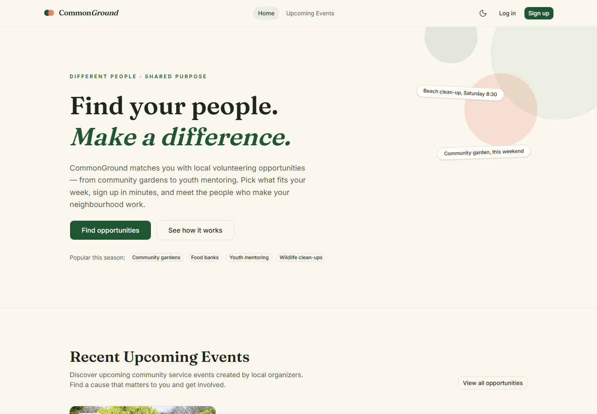
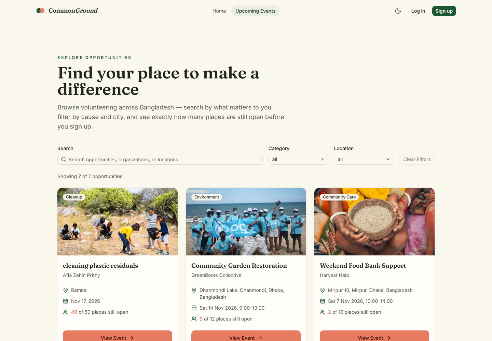
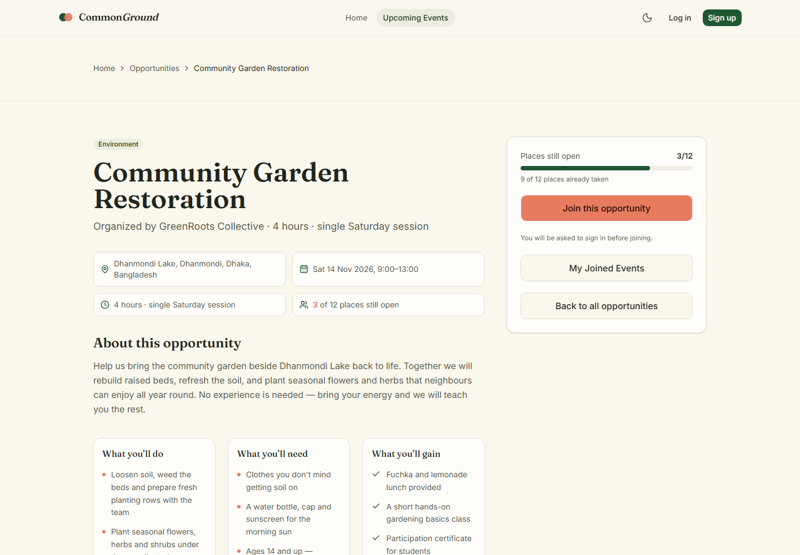
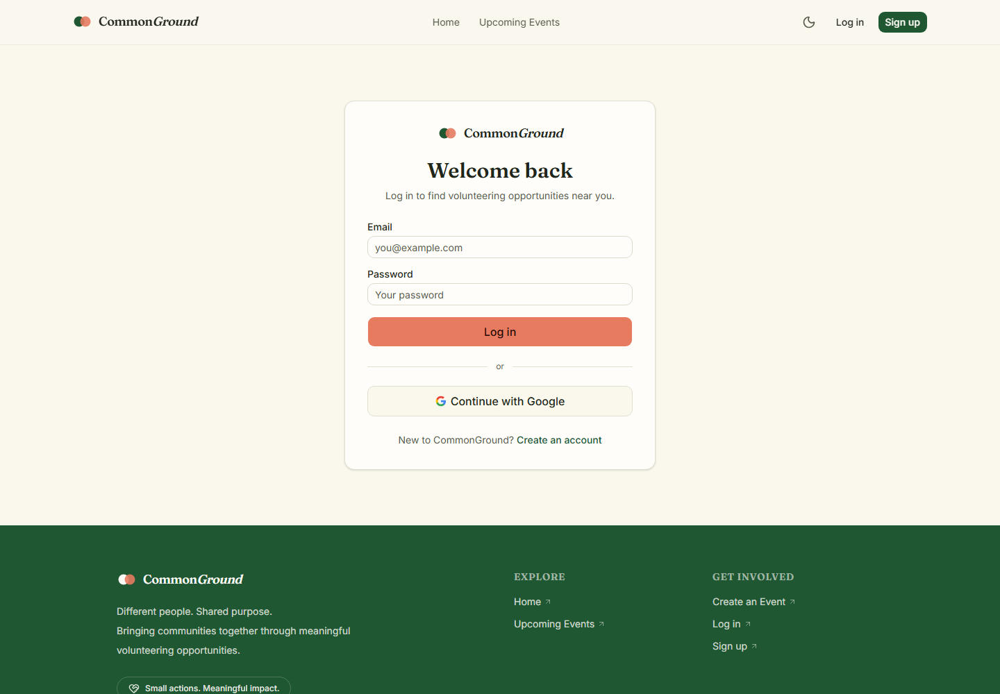
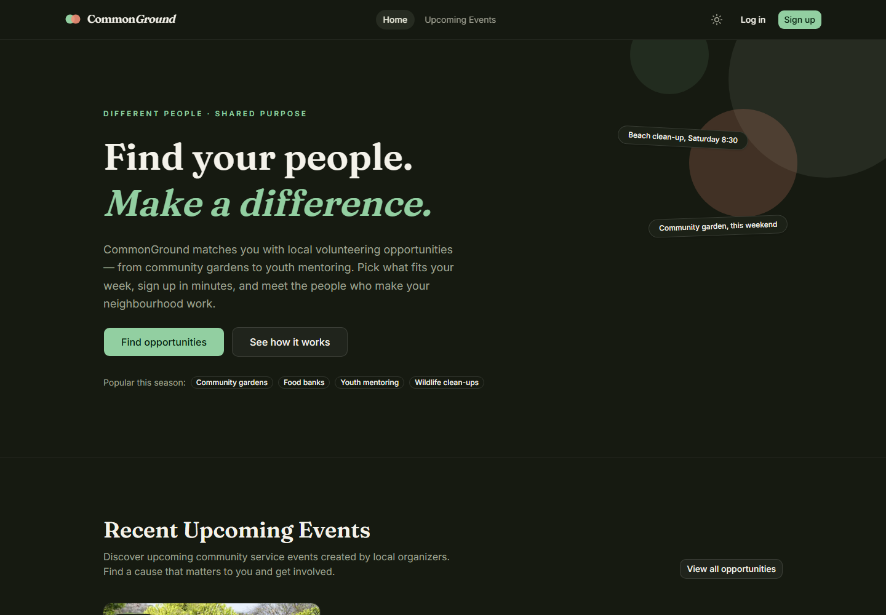
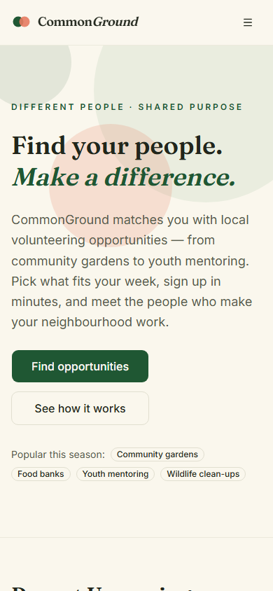

# CommonGround

### Different people. Shared purpose.

**CommonGround** is a full-stack volunteering platform that makes it easy to find, organise, and join community service events. Volunteers can discover causes near them and track their commitments; organisers can publish and manage events; and every account has a personal dashboard backed by real data.

The project is built as a portfolio-quality full-stack application: a Next.js 16 frontend, an Express + MongoDB API, BetterAuth sessions, and JWKS-verified JWTs for service-to-service authorization.

**Live site:** [commonground-client-tau.vercel.app](https://commonground-client-tau.vercel.app/)

**Repositories:** [Frontend](https://github.com/Afia611/commonground-client) · [Backend](https://github.com/Afia611/commonground-server)

---

## The problem

Community volunteering is fragmented. Opportunities live in Facebook groups, WhatsApp threads, posters, and word of mouth. Volunteers struggle to find events that fit their time and interests, while small organisers struggle to fill places and keep track of who is coming.

CommonGround gives both sides one place to work:

- Volunteers browse a live directory, see exactly how many places remain, join or leave in one click, and keep their commitments in one dashboard.
- Organisers publish events with capacity, location, date, and imagery, then edit or remove them without losing control of their listing.
- The platform never invents participation metrics. Counts shown in the product come from real MongoDB records.

## Screenshots

| Home | Opportunities |
| --- | --- |
|  |  |

| Event details | Sign in |
| --- | --- |
|  |  |

| Dark theme | Mobile |
| --- | --- |
|  |  |

> Screenshots are captured from the running application using real API data. The dashboard and profile screens require an account and are therefore not included in the public repository screenshots.

---

## Features

### For volunteers

- **Browse and search** upcoming opportunities by category and city, with live result counts.
- **Event details** with capacity, remaining places, schedule, responsibilities, requirements, and benefits.
- **Join or leave** an event; capacity updates atomically on the server.
- **Impact dashboard** showing events created, events joined, and upcoming commitments — all from real API data.
- **Joined events** page with loading skeletons, empty states, and retryable error feedback.
- **Profile page** for updating display name and profile photo, reflected immediately in the header and event listings.
- **Light and dark themes** that follow the system preference and persist across visits.

### For organisers

- **Create events** with a validated form: title, description, type, date, location, and optional thumbnail.
- **Manage events** in one place: edit inline, delete through an accessible confirmation dialog, and see availability at a glance.
- **Server-enforced ownership**: only the creator can update or delete an event, even if a token is valid.

### Platform

- **Protected routes** using Next.js 16 `proxy.ts`, with real session verification rather than cookie presence.
- **`callbackUrl` preservation** so users return to the page they originally requested after signing in.
- **Responsive layouts** across mobile, tablet, and desktop, including a mobile navigation drawer.
- **Accessible UI**: labelled controls, visible focus states, inline validation with `aria-invalid`/`role="alert"`, keyboard-friendly dialogs, and status messages.
- **Custom toast and dialog components** — no `window.alert` or `window.confirm`.
- **Loading skeletons** for data-fetching surfaces so layouts do not shift when data arrives.

---

## Architecture

CommonGround is split into two deployable applications with a shared MongoDB database.

```text
┌──────────────────────────────┐        ┌──────────────────────────────┐
│  Next.js 16 frontend         │        │  Express 5 API               │
│  (Vercel)                    │        │  (Render)                    │
│                              │        │                              │
│  • App Router pages          │  HTTPS │  • REST controllers          │
│  • BetterAuth session + JWT  │ ─────► │  • Zod request validation    │
│  • proxy.ts route protection │ Bearer │  • JWKS JWT verification     │
│  • Server + client rendering │  JWT   │  • Ownership authorization   │
└──────────────┬───────────────┘        └──────────────┬───────────────┘
               │                                       │
               │          ┌──────────────────┐         │
               └────────► │  MongoDB Atlas   │ ◄───────┘
                          │  users, events,  │
                          │  participations  │
                          └──────────────────┘
```

**Request flow for a protected API call**

1. The browser holds a BetterAuth session in an `httpOnly` cookie.
2. The frontend calls `authClient.token()` to obtain a short-lived JWT.
3. The request is sent to Express with `Authorization: Bearer <jwt>`.
4. Express verifies the signature against the frontend's published JWKS at `BETTER_AUTH_URL/api/auth/jwks`, and checks `iss`/`aud` and `sub`.
5. The controller filters by `createdBy.userId` or participation `userId`, so a valid token can only act on its owner's records.
6. MongoDB returns the result; the frontend renders it or shows an error state.

**Route protection flow**

`src/proxy.ts` runs before protected pages are rendered. It calls `auth.api.getSession({ headers: request.headers })`, which validates the signed session against the auth store. If there is no valid session, the visitor is redirected to `/login?callbackUrl=<requested path>`. Protected pages also re-check the session server-side, and Express is the final authorization boundary. The proxy is a usability and defense-in-depth layer, not the security boundary.

---

## Technology stack

| Layer | Technologies |
| --- | --- |
| Frontend | Next.js 16.4 (App Router, Turbopack), React 19, TypeScript |
| Styling | Tailwind CSS 4, shadcn/ui-style components, Base UI primitives |
| Theming | `next-themes` with semantic CSS variables |
| Icons | Lucide React |
| Authentication | BetterAuth 1.7, MongoDB adapter, JWT plugin |
| Backend | Node.js, Express 5, TypeScript |
| Authorization | `jose` JWKS verification |
| Validation | Zod (server), shared TypeScript validators (client) |
| Database | MongoDB Atlas |
| Testing | Vitest |
| Deployment | Vercel (frontend), Render (backend) |

---

## Security approach

Security is layered and explicit:

- **Sessions are server-verified.** `proxy.ts` uses BetterAuth's `getSession`, so an expired, revoked, or forged cookie is rejected. Cookie existence alone is never treated as authentication.
- **Route protection preserves intent.** The requested path and query string are stored in `callbackUrl`, while the login flow sanitises the value to prevent open redirects.
- **JWTs are verified, not decoded.** The Express middleware uses `jose` with a remote JWKS, validates issuer and audience, and requires a `sub` claim. No shared JWT secret is sent to the browser.
- **Authorization is enforced in queries.** Update and delete operations use an ownership filter (`_id` + `createdBy.userId`); joined-event queries use the authenticated user's ID.
- **Server-side validation is authoritative.** Every write is validated again with Zod, including production-only rules such as future event dates and bounded field lengths.
- **CORS is allow-listed.** Only configured frontend origins are accepted; credentials are disabled because the API uses bearer tokens.
- **Standard hardening is enabled.** Helmet sets security headers, JSON bodies are limited to 100 KB, Express banners are disabled, and errors return generic 401 responses instead of leaking internals.
- **Secrets stay out of source control.** Environment values are read from `.env.local` / `.env` and are never committed.

> Deployment note: the backend's `BETTER_AUTH_URL` and the frontend's `BETTER_AUTH_URL` must point to the **same public frontend origin** so the JWT `iss`/`aud` claims match the JWKS used for verification. `CLIENT_URL` on the backend must include the deployed frontend origin.

---

## Routes

| Route | Access | Purpose |
| --- | --- | --- |
| `/` | Public | Landing page with live upcoming events |
| `/opportunities` | Public | Searchable, filterable event directory |
| `/opportunities/[id]` | Public | Event details and join action |
| `/login` | Public | Email/password and Google sign-in |
| `/signup` | Public | Account creation |
| `/dashboard` | Protected | Impact summary and quick actions |
| `/dashboard/joined` | Protected | Events the user has joined |
| `/events/create` | Protected | Create an event |
| `/events/manage` | Protected | Edit or delete owned events |
| `/profile` | Protected | Update name and profile photo |
| `/events/joined` | Protected | Legacy redirect to `/dashboard/joined` |

### API overview

| Method | Endpoint | Access |
| --- | --- | --- |
| `GET` | `/api/health` | Public |
| `GET` | `/api/opportunities` | Public (pagination, category, city, search) |
| `GET` | `/api/opportunities/upcoming` | Public (next six events) |
| `GET` | `/api/opportunities/:id` | Public |
| `POST` | `/api/opportunities` | Bearer JWT |
| `GET` | `/api/opportunities/mine` | Bearer JWT |
| `PATCH` | `/api/opportunities/:id` | Bearer JWT + owner |
| `DELETE` | `/api/opportunities/:id` | Bearer JWT + owner |
| `GET` | `/api/opportunities/joined` | Bearer JWT |
| `POST` | `/api/opportunities/:id/join` | Bearer JWT |
| `DELETE` | `/api/opportunities/:id/join` | Bearer JWT |

---

## Local development

### Prerequisites

- Node.js 20 or newer
- npm
- A MongoDB Atlas cluster (or a local MongoDB instance)
- Google OAuth credentials only if you want social sign-in

### 1. Clone both repositories

```bash
git clone https://github.com/Afia611/commonground-client.git
git clone https://github.com/Afia611/commonground-server.git
```

### 2. Configure the backend

```bash
cd commonground-server
npm install
```

Create `commonground-server/.env`:

```env
NODE_ENV=development
PORT=5000
MONGODB_URI=your_mongodb_connection_string
DB_NAME=commonground
CLIENT_URL=http://localhost:3000
JWT_SECRET=a_long_random_local_secret
BETTER_AUTH_URL=http://localhost:3000
```

> `JWT_SECRET` is a retained backend setting, but protected APIs verify BetterAuth JWTs through JWKS, not a shared secret. Keep the value random anyway so no legacy code path can use a weak default.

Start the API:

```bash
npm run dev
```

Optional: seed sample events with `npm run seed`.

### 3. Configure the frontend

```bash
cd ../commonground-client
npm install
```

Create `commonground-client/.env.local`:

```env
BETTER_AUTH_SECRET=a_long_random_local_secret
BETTER_AUTH_URL=http://localhost:3000
MONGODB_URI=your_mongodb_connection_string
DB_NAME=commonground
NEXT_PUBLIC_API_URL=http://localhost:5000

# Optional social sign-in
GOOGLE_CLIENT_ID=your_google_client_id
GOOGLE_CLIENT_SECRET=your_google_client_secret
```

Start Next.js:

```bash
npm run dev
```

Open [http://localhost:3000](http://localhost:3000).

> `BETTER_AUTH_SECRET` signs BetterAuth sessions. `JWT_SECRET` is not part of the API token verification path — the backend trusts only JWTs signed by the frontend's published JWKS. Never commit either environment file.

### 4. Verify the build

```bash
npm run lint
npx tsc --noEmit
npm test
npm run build
```

---

## Deployment

| Service | Platform | Required configuration |
| --- | --- | --- |
| Frontend | Vercel | `BETTER_AUTH_SECRET`, `BETTER_AUTH_URL`, `MONGODB_URI`, `DB_NAME`, `NEXT_PUBLIC_API_URL`, optional Google OAuth values |
| Backend | Render | `NODE_ENV=production`, `PORT`, `MONGODB_URI`, `DB_NAME`, `CLIENT_URL` (comma-separated origins), `JWT_SECRET`, `BETTER_AUTH_URL` |
| Database | MongoDB Atlas | Network access for Render and Vercel; separate database user with least privilege |

For production, set both `BETTER_AUTH_URL` values to the deployed frontend origin, for example `https://commonground-client-tau.vercel.app`, and add that origin to the backend's `CLIENT_URL`.

---

## Project structure

```text
commonground-client/
├── docs/screenshots/          # README screenshots
├── public/gallery/            # Community gallery imagery
├── src/
│   ├── app/                   # App Router pages and API mount
│   │   ├── dashboard/         # Impact dashboard and joined events
│   │   ├── events/            # Create, manage, legacy joined route
│   │   ├── opportunities/     # Listing and detail routes
│   │   ├── profile/           # Protected profile page
│   │   └── login, signup      # Authentication pages
│   ├── components/
│   │   ├── auth/              # Login and signup forms
│   │   ├── events/            # Create/manage event UI
│   │   ├── landing/           # Home page sections
│   │   ├── layout/            # Header, footer, logo
│   │   ├── opportunities/     # Cards, filters, state panels
│   │   ├── profile/           # Profile editor
│   │   ├── ui/                # Reusable primitives and toast
│   │   ├── theme-provider.tsx
│   │   └── theme-toggle.tsx
│   ├── data/                  # Shared TypeScript types
│   ├── lib/                   # Auth, API, validation helpers
│   └── proxy.ts               # Next.js 16 route protection
└── tests/                     # Vitest unit tests
```

---

## Design decisions

- **Real data over demo data.** Production surfaces read from the API. Where sample content is used for local development, it is clearly labelled and never presented as live impact.
- **No invented impact numbers.** The dashboard reports created events, joined events, and upcoming commitments from actual records. Hours and attendance are intentionally not fabricated.
- **Server components where they help, client components where they must.** Public pages fetch on the server; interactive filters, forms, theme switching, and session-aware navigation are client components.
- **One design system.** Warm cream, forest green, and coral are expressed through semantic CSS variables so every page, dialog, skeleton, and theme state stays consistent.
- **Failure states are designed.** Skeletons, empty states, inline validation, and retry actions are part of the feature rather than an afterthought.

## Known limitations

- Email verification and password reset are intentionally out of scope for this assignment.
- Profile photos are stored as public URLs rather than uploaded files.
- Participation history is limited to currently joined and upcoming events; there is no attendance archive yet.
- The proxy verifies the session on every protected navigation, which is correct but adds a database round-trip compared with cookie-only checks.

## Roadmap

- Search and filtering across additional event attributes
- Organiser profiles and public event history
- Event reminders and email notifications
- Attendance tracking and verified participation hours
- Richer impact reporting based on real attendance data

---

## Author

**Afia Zahin**

GitHub: [@Afia611](https://github.com/Afia611)

---

**CommonGround — Different people. Shared purpose.**

*Bringing communities together through meaningful action.*
